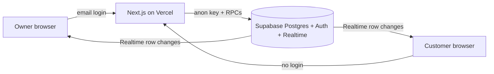

# Queue

A live desk line for a clinic or salon. The owner runs one queue from a single screen. Customers scan a QR, type a name, and watch their place and wait update. No phone numbers.

| | |
| --- | --- |
| **Live** | https://callnext.space/ |
| **Source** | https://github.com/Hollenite/MERN-endTerm |
| **Demo video** | https://www.youtube.com/watch?v=CLFqAdGS9Ag |


The live site is the accessible build. On production, use **Create account** (or **Owner login**). The `demo@queue.local` seed owner is for local development only, not a production login.

## Try it

These are the major workflows. The demo video should follow the same path.

### Owner

1. Open [https://callnext.space/](https://callnext.space/) and choose **Open a desk** (or **Create account**).
2. Create an owner account and land on the hub.
3. **+ New queue**, give it a name and an average service time.
4. Open the queue so customers can join.
5. Show the QR, **Copy join link**, or **Open waiting room**.
6. **Add** a walk-in by name (Enter submits).
7. **Call next**, then **Done**, **No-show**, or **Put back**. Waiting phones update immediately.

### Customer

1. Scan the desk QR, or open **Scan QR** (`/scan`) and point the camera at it.
2. Type a display name and join. No phone number, no account.
3. Watch place in line and an “about N min” wait on the live ticket.
4. When the desk calls you, the ticket shows **You’re in**.

### Waiting room

Open `/q/[id]/wall` on a counter display. It stays in sync with the desk: who is being seen, who is next, and the join QR.

## Stack

- **Next.js 16** (App Router) on Vercel Hobby: owner hub, desk board, join, live ticket, waiting room, scan.
- **Supabase Postgres + Auth + Realtime**: queues and entries; owner email/password; live row changes to open browsers.
- **Tailwind v4** for the desk and landing UI.
- **PWA** shell with an offline fallback. The live ticket still needs a network.
- **RPC-only writes**: join, leave, call next, finish, and desk ops go through Postgres functions, not client table writes.

## Architecture



## Engineering decisions

- **Postgres Realtime instead of a custom WebSocket server.** Vercel’s serverless runtime cannot hold persistent connections. The database already has the truth, so broadcasting row changes is cheaper and stays on the free tier.
- **`FOR UPDATE SKIP LOCKED` on `call_next`.** Two clicks at once must not serve the same person. Skip locked hands each caller a different waiting row, or none, in a single transaction. The headline concurrency test is `tests/concurrency.test.ts`.
- **RPC-only writes.** Anonymous clients can read the public board (name, status, joined time) but cannot insert or update rows. Join, leave, call next, and finish run as `SECURITY DEFINER` functions that enforce queue-open, token match, and ownership.
- **No phone numbers.** A `client_token` in `localStorage` is enough to leave your own entry. That keeps the product off paid SMS and off collecting numbers.

See [docs/adr/0001-rpc-only-writes.md](docs/adr/0001-rpc-only-writes.md).

## Setup

1. Create a Supabase project. Confirm it is not paused.
2. In the SQL editor, run [`supabase/migrations/0001_init.sql`](supabase/migrations/0001_init.sql), then [`supabase/migrations/0002_desk_ops.sql`](supabase/migrations/0002_desk_ops.sql), then [`supabase/migrations/0003_confirm_owner.sql`](supabase/migrations/0003_confirm_owner.sql).
3. Copy env vars:

   ```bash
   cp .env.example .env.local
   ```

   Fill in `NEXT_PUBLIC_SUPABASE_URL` and `NEXT_PUBLIC_SUPABASE_ANON_KEY`. Put `SUPABASE_SERVICE_ROLE_KEY` in `.env.local` only (seed + concurrency tests).

4. Install and run:

   ```bash
   npm install
   npm run dev
   ```

5. Optional demo data (creates the demo owner if missing, then a “Front desk” queue):

   ```bash
   npm run seed
   ```

6. In the Supabase dashboard, Authentication → Providers → Email: turn **Confirm email** off so Auth does not send a message on **Create account** (the built-in mailer is 2/hour and team inboxes only). `0003_confirm_owner.sql` still confirms the row so they can sign in even if that toggle is on. Seed still confirms the demo owner.

7. Deploy to Vercel. Set the two `NEXT_PUBLIC_*` values. Enable GitHub Actions and set repository variable `APP_URL` to the production origin so the daily keep-alive ping can hit `/api/health`.

### Local demo owner

After `npm run seed` (or after creating the user in Supabase Auth), local sign-in is:

- Email: `demo@queue.local`
- Password: `demo-pass-12345`

This is **local seed only**. Do not use it on the live site. Change this password if you share a local project.

## Secrets

- [`.env.example`](.env.example) holds placeholders only. Real keys stay in `.env.local`.
- `.env*` is gitignored (`.env.example` is the exception).
- Never commit API keys, tokens, or the service-role key. Never put the service-role key in `NEXT_PUBLIC_*`.
- This README has no production credentials.

## Tests

```bash
npm test
```

- **Wait estimate** (`tests/wait-estimate.test.ts`): no history, fewer than 3 samples, and a full 20-sample average.
- **Concurrency** (`tests/concurrency.test.ts`): fires parallel `call_next` calls and asserts no duplicate serving ids. Needs the service-role key and a reachable project; otherwise Vitest skips it.

## Known limitations

- One owner per queue. There is no staff roster.
- A customer is this browser’s token, not a person. Clearing site data or switching phones loses the ticket.
- Wait time is a coarse “about N min” label from recent `done` visits, not a promise.
- Supabase free projects pause after about a week idle; the keep-alive workflow is there so evaluation does not hit a sleeping database.

## Demo video (~3 minutes)

**URL:** https://www.youtube.com/watch?v=CLFqAdGS9Ag

Two windows side by side. Cover the same workflows as [Try it](#try-it):

1. Owner creates a queue and shows the QR.
2. Customer A joins; their place appears on both screens.
3. Customer B joins; A’s wait label updates.
4. Owner calls next; A’s phone shows “You’re in”, B moves up live.
5. Finish a few visits and show the wait estimate using real samples.
6. End on this README and `tests/concurrency.test.ts`.
