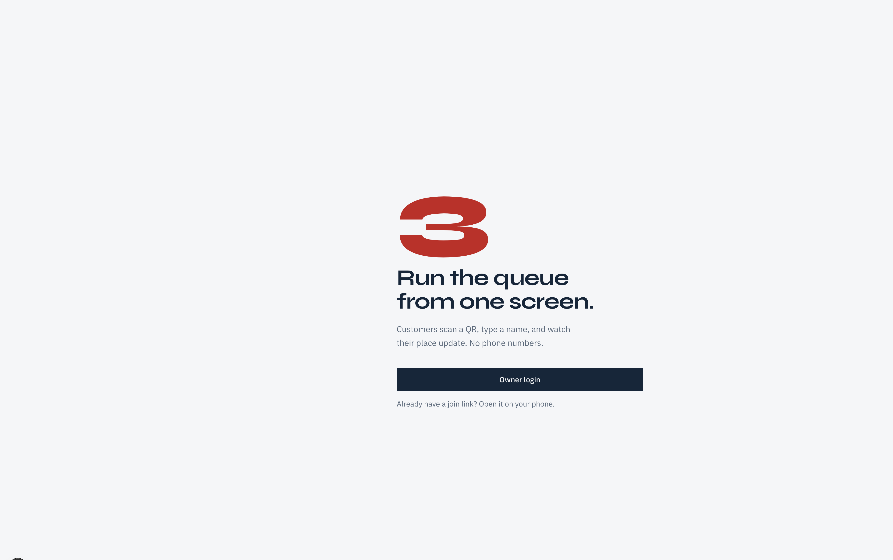
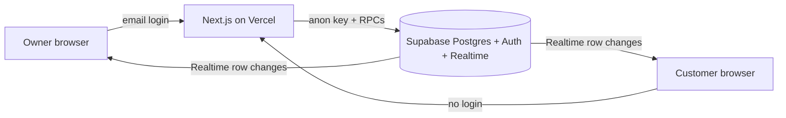

# Queue

A live queue for a clinic or salon. The owner opens a queue, customers join with a name (no phone number), and everyone watches position and wait update in realtime.

**Live:** _add your Vercel URL after deploy_



## What it does

1. Owner signs in, creates a queue, and shows a QR / join link.
2. A customer opens the link, types a name, and sees their place and an “about N min” wait.
3. The owner hits **Call next**, then **Done** or **No-show**. Customer screens update immediately.

## Architecture



- **Next.js (App Router)** on Vercel Hobby renders the owner dashboard and customer ticket pages.
- **Supabase Postgres** stores queues and entries. All writes go through SQL RPCs.
- **Supabase Auth** is owner-only (email + password).
- **Supabase Realtime** pushes `queue_entries` / `queues` changes to open browsers.
- **PWA**: installable shell plus an offline fallback. The live ticket still needs a network.

## Engineering decisions

- **Postgres Realtime instead of a custom WebSocket server.** Vercel’s serverless runtime cannot hold persistent connections. The database already has the truth, so broadcasting row changes is cheaper and stays on the free tier.
- **`FOR UPDATE SKIP LOCKED` on `call_next`.** Two clicks at once must not serve the same person. Skip locked hands each caller a different waiting row, or none, in a single transaction. This is the headline concurrency test in `tests/concurrency.test.ts`.
- **RPC-only writes.** Anonymous clients can read the public board (name, status, joined time) but cannot insert or update rows. Join, leave, call next, and finish run as `SECURITY DEFINER` functions that enforce queue-open, token match, and ownership.
- **No phone numbers.** A `client_token` in `localStorage` is enough to leave your own entry. That keeps the product off paid SMS and off collecting numbers.

See [docs/adr/0001-rpc-only-writes.md](docs/adr/0001-rpc-only-writes.md).

## Setup

1. Create a Supabase project. Confirm it is not paused.
2. In the SQL editor, run [`supabase/migrations/0001_init.sql`](supabase/migrations/0001_init.sql).
3. Copy env vars:

   ```bash
   cp .env.example .env.local
   ```

   Fill in `NEXT_PUBLIC_SUPABASE_URL` and `NEXT_PUBLIC_SUPABASE_ANON_KEY`. Put `SUPABASE_SERVICE_ROLE_KEY` in `.env.local` only (seed + concurrency tests). Never commit it. Never put it in `NEXT_PUBLIC_*`.

4. Install and run:

   ```bash
   npm install
   npm run dev
   ```

5. Optional demo data (creates the demo owner if missing, then a “Front desk” queue):

   ```bash
   npm run seed
   ```

6. Deploy to Vercel. Set the two `NEXT_PUBLIC_*` values. Enable GitHub Actions and set repository variable `APP_URL` to the production origin so the daily keep-alive ping can hit `/api/health`.

### Demo owner

After `npm run seed` (or after creating the user in Supabase Auth):

- Email: `demo@queue.local`
- Password: `demo-pass-12345`

Change this password if the project is public.

## Tests

```bash
npm test
```

- **Wait estimate** (`tests/wait-estimate.test.ts`): no history, fewer than 3 samples, and a full 20-sample average.
- **Concurrency** (`tests/concurrency.test.ts`): fires parallel `call_next` calls and asserts no duplicate serving ids. Needs the service-role key and a reachable project; otherwise Vitest skips it.

## Known limitations

- One owner per queue. There is no staff roster.
- A customer is this browser’s token, not a person. Clearing site data or switching phones loses the ticket.
- Wait time is a coarse “about N min” label from recent `done` visits, not a promise.
- Supabase free projects pause after about a week idle; the keep-alive workflow is there so evaluation does not hit a sleeping database.

## Demo video script (~3 minutes)

Two windows side by side.

1. Owner creates a queue and shows the QR.
2. Customer A joins; their place appears on both screens.
3. Customer B joins; A’s wait label updates.
4. Owner calls next; A’s phone shows “You’re in”, B moves up live.
5. Finish a few visits and show the wait estimate using real samples.
6. End on this README and `tests/concurrency.test.ts`.
